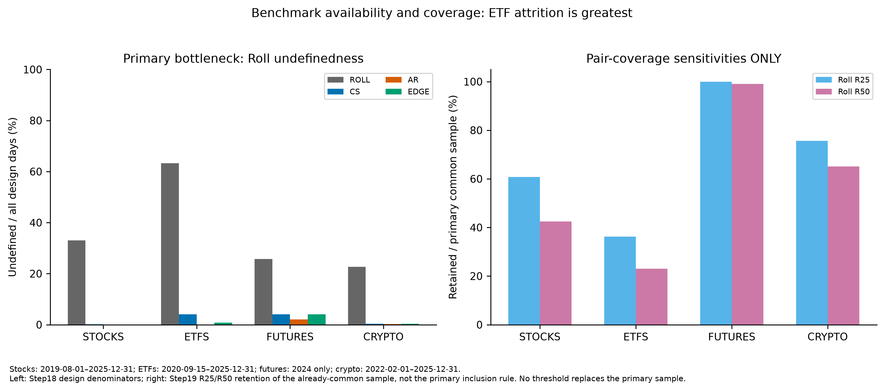
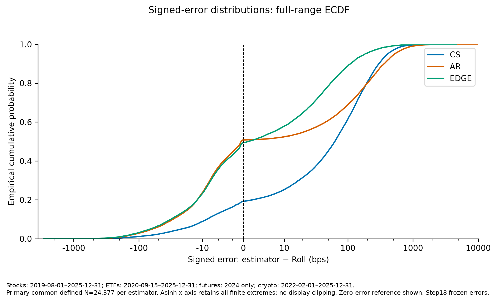
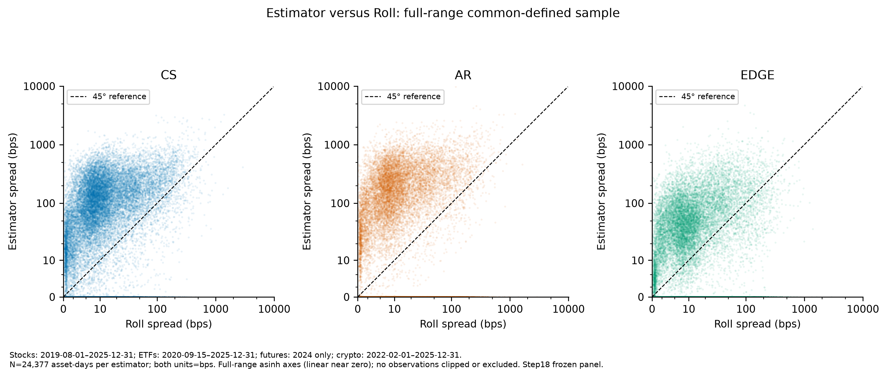
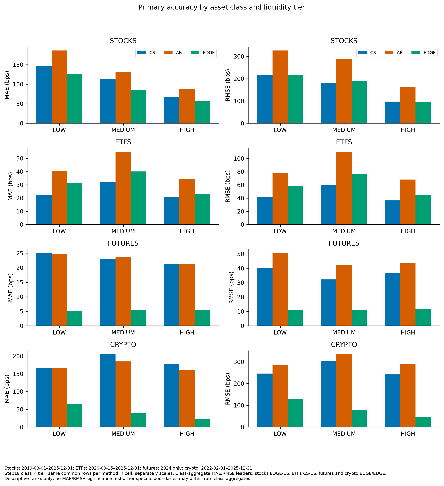
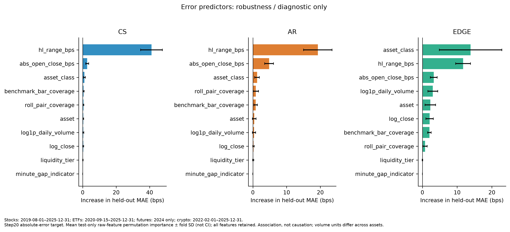

# Which Daily OHLC Spread Estimator Tracks Realized Intraday Cost? A CS / AR / EDGE Horse-Race

## Abstract

Daily OHLC prices permit spread estimation when detailed trade and quote records are unavailable. This paper compares daily spread estimators across liquidity-stratified stocks, ETFs, futures and crypto against a common intraday proxy. Corwin–Schultz (CS), Abdi–Ranaldo (AR) and EDGE are compared with a one-minute, simple-return Roll benchmark under frozen source, session, daily-mapping and negative-value conventions. The common-defined sample comprises 24,377 asset-days. EDGE records the lowest overall mean absolute error and root mean squared error, at 53.59 and 122.18 basis points, respectively. Universal EDGE dominance is not supported: ETFs favor CS on both accuracy metrics, while stocks favor EDGE on mean absolute error and CS on root mean squared error. The hypothesis of downward CS bias in low-liquidity cells is contradicted by positive observed bias, and estimator rankings differ across asset classes. Overall EDGE leadership survives the applicable prespecified robustness checks, although stock and thin-ETF conclusions are less stable. Secondary cross-fitted models identify predictable error variation associated with daily price ranges and asset class, without constituting a new spread estimator or a trading forecast. The principal qualification is substantial benchmark undefinedness: accuracy is measured conditional on all methods being defined, rather than on the entire intended universe of trading days. Consequently, the evidence supports asset-class and error-criterion-specific method choice, not universal superiority or inference about true execution costs.

## 1. Introduction

Transaction costs affect portfolio turnover, implementation capacity and the interpretation of apparent return predictability. Yet the information needed to measure effective spreads directly is less readily available than daily price summaries. A daily estimator is attractive because it permits broad coverage without requiring a complete trade-and-quote history. Its practical value nevertheless depends on whether the information discarded by daily aggregation matters differently across market structures and trading activity. A convenient estimator need not be a reliable substitute for the cost concept that motivates its use.

This paper asks: across asset classes and liquidity tiers, which daily-OHLC spread estimator best matches an intraday benchmark, and where do the methods break down? The comparison concerns Corwin–Schultz, Abdi–Ranaldo and EDGE. The reference is a one-minute Roll-type measure constructed from transaction-price bar closes. The exercise therefore evaluates agreement with a common proxy, rather than identifying the estimator closest to an observed fundamental price or a quote-based ground truth.

The original expectations were recorded before provider performance was calculated. EDGE was expected to dominate accuracy and negative-estimate rates. CS was expected to exhibit downward bias in thin or non-continuous markets. Estimator rankings were expected to be broadly stable across asset classes, while error levels were expected to diverge most in crypto and low-liquidity equities. These directional expectations remain the benchmark for interpretation even where the results contradict them. The selected equity tiers represent liquidity, not a separately validated small-cap classification.

The contribution is an explicitly comparable asset-day horse race under a frozen benchmark and transparent daily mappings. Accuracy uses identical observations for competing methods, while failure and raw-negative rates retain their own appropriate denominators. The completed classes span equities, ETFs, futures and crypto; official FX access remains blocked. Within-class liquidity stratification permits conditional comparisons without treating turnover in unlike units as a universal cross-market scale. Prespecified sensitivities examine coverage, weighting, input adjustment and negative correction, while a separate cross-fitted exercise describes error predictability.

The paper distinguishes confirmatory primary analysis from prespecified robustness and secondary diagnostics. The primary comparison answers the frozen hypotheses; the sensitivities assess their boundaries without replacing the original sample. Predictive error models are interpretive diagnostics rather than a mechanism for correcting spreads or revising the preferred specification. This separation prevents a favorable sensitivity or model fit from being substituted retrospectively for the intended comparison.

The evidence supports overall EDGE leadership, particularly in futures and crypto, but does not support universal dominance. ETFs favor CS, and stock conclusions depend on the loss function. Estimator ranking is not stable across asset classes, contradicting the original ranking-stability expectation. Positive CS bias in LOW-tier cells contradicts the directional downward-bias expectation. Some negative-rate and error-level expectations receive only partial support. The relevant economic conclusion is thus conditional method choice, subject to benchmark selection and the sampled markets.

## 2. Data and Sample Construction

The original research horizon spans the project’s intended historical study period, but available common support differs by class. The final universe covers stocks, ETFs, futures and crypto. FX remains in scope but unavailable because access to the official RiskLab archive was blocked; no substitute FX data were used. This is a source limitation, not an intentional exclusion based on market behavior or estimator results.

Stock and ETF estimator inputs are Bloomberg adjusted daily OHLC. The saved acquisition specifies capital-change and normal cash-dividend adjustment, while abnormal-dividend adjustment remains unspecified. Unadjusted Bloomberg data serve only as robustness inputs. Their benchmark uses official First Rate one-minute files accessed through RiskLab. Local equity daily aggregates are validation material; equivalence with Bloomberg sessions and adjustment conventions is not assumed. Bloomberg daily bid and ask fields are not the intraday benchmark.

Futures daily OHLC and the benchmark originate from individual, unadjusted First Rate contracts selected using the provider’s contract-date mapping. A single selected contract supplies the entire overnight trade-date session. Continuous back-adjusted prices and silent fallback contracts are prohibited, and required estimator context cannot cross a selected-contract boundary. Crypto daily OHLC and Roll similarly derive from validated First Rate minute observations under a common provider quote basis. This shared input source creates dependence between daily estimates and benchmark errors that is absent from a fully independent validation design.

Each completed class contains 9 selected assets or futures roots, with three assigned to each liquidity tier. Liquidity tiers are descriptive classifications calibrated on 2024 turnover, rather than trading signals or rankings based on estimator outcomes. Ranking is independent within each class, and deterministic within-tier rank targets determine the sample rather than familiar security names. Security-type corrections were made before the analytic comparison. The complete universe appears in the appendix notes; the eligibility and identity audits remain part of the frozen lineage. REIT common shares and ADR/ADS lines are permitted, while unresolved IMDX historical continuity is retained as a limitation rather than repaired by discretionary ticker stitching.

Stock design support runs from 2019-08-01 through 2025-12-31. ETF design support runs from 2020-09-15 through 2025-12-31. Futures primary support is confined to 2024, from 2024-01-02 through 2024-12-31. Crypto design support runs from 2022-02-01 through 2025-12-31. These are frozen design boundaries, not a claim that every estimator is defined on every endpoint. Within each class, exact common source dates establish temporal comparability across liquidity tiers before outcome-definedness is applied. Extra asset-specific historical support is supplementary. The pooled comparison is neither a single balanced historical panel nor a design that identifies a pure asset-class effect holding calendar conditions fixed.

Equity benchmark bars are retained only from 09:30 inclusive to 16:00 exclusive in America/New_York; crypto uses UTC calendar days, and the selected futures use verified previous-evening 18:00 to trade-date 17:00 sessions. Maintenance periods, missing minutes and absent days are not filled. Sparse bars and zero-volume observations are retained with diagnostics. Daily context follows the frozen scheduled-source grid; a missing required period is not replaced by the next available observation. This distinction preserves the intended estimator horizon even when the scored common sample has gaps.

The frozen design contains 38,232 eligible asset-days, of which 24,377 are common-defined for the primary comparison. The common sample contains 9,707 stock, 3,175 ETF, 1,667 futures and 9,828 crypto asset-days. Roll is undefined on 35.93% of all design-eligible days and 63.22% of ETF design days. Only 117 further asset-days are lost between the Roll-defined set and the all-method common sample. Method-defined sets overlap, so their individual failure counts cannot be added as sequential losses. The [Appendix Table](../outputs/tables/appendix_data_lineage_attrition.md) traces these parallel sets, and [Figure 4](../outputs/figures/figure4_benchmark_coverage.png) shows benchmark availability and coverage sensitivities. Roll is the principal attrition bottleneck, especially for ETFs. The accuracy estimand is consequently conditional on joint computability, not representative performance over all intended asset-days.

### Figure 4. Roll undefinedness and pair-coverage sensitivities. The right panel is robustness evidence, not the primary sample.

## 3. Methodology

The unit of observation is the asset-day. [Table 1](../outputs/tables/table1_estimator_definitions_and_coverage.md) summarizes required inputs, daily mappings, output conventions and usable counts. The implementation separates mathematical formulae from project-specific temporal assignment. This matters because applying a spread formula over a short surrounding window is not equivalent to observing a target-day effective spread directly.

For Roll, simple close-to-close returns are computed only when successive retained timestamps are exactly one minute apart. A lag-one covariance pair requires two consecutive valid returns and therefore a physical chain of three equally spaced closes within the same session. The sample covariance uses separately centered paired-return vectors and the ordinary sample denominator. The mathematical minimum is two valid covariance pairs; for negative covariance the relative spread equals twice the square root of its absolute value. Nonnegative covariance and insufficient pairs leave the benchmark undefined, never converted to zero. No gaps are bridged and no minutes are synthesized. The minimum establishes mathematical computability rather than statistical reliability; coverage diagnostics remain available without imposing an additional primary reliability cutoff.

The percentage-return adaptation follows the interpretation documented for Roll’s implicit-spread logic. It remains a sampled transaction-close proxy rather than a quote-based effective spread or NBBO execution-cost measure. Aggregation, non-spread price variation and finite-sample covariance behavior can therefore contribute to disagreement. A low error against Roll establishes proximity to this benchmark under the chosen conventions, not accuracy against an independently observed economic cost.

CS uses high-low information to separate components associated with price variation and spread. The implementation applies the official additive overnight adjustment and computes the nonlinear spread from adjacent-session range moments. The project assigns a daily value by averaging the corrected intervals immediately before and after the target session. Both intervals are required, and each finite raw interval is floored separately before averaging. This is an explicit project mapping supported by overlapping-interval applications, not an additional closed-form estimator attributed to the authors.

AR combines the target close with the midpoint of daily high and low log prices on the target and next scheduled session. Its two-day moment is assigned to the target date, with the published zero-floor correction applied before taking the square root. A following close is unnecessary for this particular moment. The common primary preprocessing does not import the author empirical implementation’s carry-forward or other sample repairs: missing formula-required inputs remain missing rather than becoming synthetic observations.

EDGE combines information from all daily OHLC log-price components through its efficient moment combination. The primary project mapping uses the centered three-session sample surrounding the target date and the published paper’s zero-floor convention. This estimates a local root-mean-square spread, not an instantaneous target-day spread. The short centered window is a project choice, not an author recommendation for an optimal daily horizon. The official package’s absolute-root convention is a named sensitivity only. These mappings use future-session context for ex-post measurement and are not executable contemporaneous trading signals.

The common-defined accuracy sample is the conjunction of design eligibility and defined Roll, CS, AR and EDGE outputs. Competing methods are scored on identical asset-days so that differences in missingness cannot mechanically create different accuracy samples. A finite negative raw estimate remains mathematically computable even when its corrected primary spread equals zero. Failure rates instead use all design-eligible days; raw-negative rates use only the method’s finite raw-computable design days. Neither denominator is replaced by the common accuracy sample.

Signed error is estimator spread minus Roll spread. Bias is its mean, MAE the mean absolute error, and RMSE the square root of mean squared error. Relative outputs are converted to basis points for presentation. Positive bias means an estimator exceeds Roll on average. Every contributing asset-day has equal primary weight; no trimming, winsorization or magnitude-based exclusion is introduced. MAE measures typical absolute discrepancy, whereas RMSE places greater weight on large errors, allowing the criteria to yield different rankings.

Inference is restricted to signed bias. The frozen HAC procedure forms chronological date-level mean errors and estimates a count-weighted intercept, preserving the pooled asset-day point estimate. A Bartlett Newey–West covariance estimator uses a deterministic lag rule based only on contributing-date count, without a small-sample correction; normal-reference intervals and two-sided probabilities concern mean bias. No significance test was specified for MAE or RMSE differences. All accuracy rankings are therefore descriptive, and nominal bias inference does not imply a multiplicity-adjusted or comprehensive panel-dependence analysis.

### Table 1. Estimator definitions and usable observations

Definedness uses all design days. Raw-negative rates use finite RAW-computable denominators, not failure denominators. Formulas/mappings are concise summaries of the frozen specifications.

| asset class | estimator | design eligible N | defined N | undefined N | failure rate | raw negative rate | raw computable N | primary start | primary end | status |
| --- | --- | --- | --- | --- | --- | --- | --- | --- | --- | --- |
| ALL | ROLL | 38232 | 24494 | 13738 | 0.359332 | unavailable / blocked | unavailable / blocked | class-specific | class-specific | PRIMARY FROZEN |
| ALL | CS | 38232 | 37708 | 524 | 0.0137058 | 0.396255 | 37708 | class-specific | class-specific | PRIMARY FROZEN |
| ALL | AR | 38232 | 38136 | 96 | 0.00251099 | 0.48251 | 38136 | class-specific | class-specific | PRIMARY FROZEN |
| ALL | EDGE | 38232 | 38001 | 231 | 0.00604206 | 0.393726 | 38001 | class-specific | class-specific | PRIMARY FROZEN |
| crypto | ROLL | 12753 | 9867 | 2886 | 0.2263 | unavailable / blocked | unavailable / blocked | 2022-02-01 | 2025-12-31 | PRIMARY FROZEN |
| crypto | CS | 12753 | 12702 | 51 | 0.00399906 | 0.347819 | 12702 | 2022-02-01 | 2025-12-31 | PRIMARY FROZEN |
| crypto | AR | 12753 | 12723 | 30 | 0.00235239 | 0.498153 | 12723 | 2022-02-01 | 2025-12-31 | PRIMARY FROZEN |
| crypto | EDGE | 12753 | 12702 | 51 | 0.00399906 | 0.431428 | 12702 | 2022-02-01 | 2025-12-31 | PRIMARY FROZEN |
| etfs | ROLL | 8649 | 3181 | 5468 | 0.632212 | unavailable / blocked | unavailable / blocked | 2020-09-15 | 2025-12-31 | PRIMARY FROZEN |
| etfs | CS | 8649 | 8294 | 355 | 0.0410452 | 0.480468 | 8294 | 2020-09-15 | 2025-12-31 | PRIMARY FROZEN |
| etfs | AR | 8649 | 8640 | 9 | 0.00104058 | 0.470023 | 8640 | 2020-09-15 | 2025-12-31 | PRIMARY FROZEN |
| etfs | EDGE | 8649 | 8577 | 72 | 0.00832466 | 0.370176 | 8577 | 2020-09-15 | 2025-12-31 | PRIMARY FROZEN |
| futures | ROLL | 2331 | 1730 | 601 | 0.257829 | unavailable / blocked | unavailable / blocked | 2024-01-02 | 2024-12-31 | PRIMARY FROZEN |
| futures | CS | 2331 | 2237 | 94 | 0.040326 | 0.375056 | 2237 | 2024-01-02 | 2024-12-31 | PRIMARY FROZEN |
| futures | AR | 2331 | 2284 | 47 | 0.020163 | 0.476795 | 2284 | 2024-01-02 | 2024-12-31 | PRIMARY FROZEN |
| futures | EDGE | 2331 | 2237 | 94 | 0.040326 | 0.394725 | 2237 | 2024-01-02 | 2024-12-31 | PRIMARY FROZEN |
| stocks | ROLL | 14499 | 9716 | 4783 | 0.329885 | unavailable / blocked | unavailable / blocked | 2019-08-01 | 2025-12-31 | PRIMARY FROZEN |
| stocks | CS | 14499 | 14475 | 24 | 0.00165529 | 0.393782 | 14475 | 2019-08-01 | 2025-12-31 | PRIMARY FROZEN |
| stocks | AR | 14499 | 14489 | 10 | 0.000689703 | 0.477121 | 14489 | 2019-08-01 | 2025-12-31 | PRIMARY FROZEN |
| stocks | EDGE | 14499 | 14485 | 14 | 0.000965584 | 0.374456 | 14485 | 2019-08-01 | 2025-12-31 | PRIMARY FROZEN |
| fx | ALL | unavailable / blocked | unavailable / blocked | unavailable / blocked | unavailable / blocked | unavailable / blocked | unavailable / blocked | unavailable / blocked | unavailable / blocked | IN SCOPE BUT BLOCKED OFFICIAL SOURCE ACCESS |

| estimator | conceptual formula | required inputs | daily mapping | negative treatment | units |
| --- | --- | --- | --- | --- | --- |
| ROLL | 2 sqrt(-sample lag-1 covariance of adjacent simple one-minute returns) | One-minute close; exact physical three-close chains | Within frozen asset-session/day; ddof=1; minimum 2 pairs | Nonnegative covariance undefined/NaN; never zero | dimensionless relative spread; bps=10000*relative |
| CS | Overnight-adjusted two-session beta/gamma -> alpha -> 2 tanh(alpha/2) | H/L at t-1,t,t+1; close at t-1,t | Mean corrected intervals (t-1,t) and (t,t+1); both required | Floor each finite interval separately before averaging; retain raw daily signed mean | dimensionless relative spread; bps=10000*relative |
| AR | s2=4(log(C t)-eta t)(log(C t)-eta (t+1)); eta=(log(H)+log(L))/2 | H/L at t,t+1; close t | Assigned to target t; no carry-forward or author empirical imputation | sqrt(max(s2,0)); finite negative raw moment remains defined | dimensionless relative spread; bps=10000*relative |
| EDGE | Published Eq26 minimum-variance combination of OHLC log-return moments | OHLC at t-1,t,t+1 | Centered three scheduled sessions; local RMS spread assigned to t | sqrt(max(raw s2,0)); abs-root is robustness only | dimensionless relative spread; bps=10000*relative |

Stocks: 2019-08-01–2025-12-31; ETFs: 2020-09-15–2025-12-31; futures: 2024 only; crypto: 2022-02-01–2025-12-31. FX: in scope but blocked official source access. Roll is a transaction-close proxy, not true effective spread or NBBO cost. Roll undefinedness is the main sample bottleneck; ETF availability is especially low. Common-defined conditioning can create economic selection; no reliability cutoff beyond frozen computability is primary. Classes have different calendar support; this is not a balanced 2015–2025 all-class panel. Futures primary analysis is 2024 only; supplementary heterogeneous histories are not the primary tier comparison. Liquidity tiers use 2024 information, including ex-post/look-ahead classification before 2024 and an in-calibration-year futures comparison. Futures and crypto share minute sources between daily OHLC and Roll, creating mechanical dependence. Crypto formal quote currency remains UNKNOWN; no USD spread claim is made. Bloomberg CshAdjAbnormal is UNKNOWN; acquired adjustment/session equivalence with local First Rate is not certified. IMDX historical economic-identity continuity is not independently certified; no manual OCX stitching. FX remains in scope but blocked by official sharing/synchronization access; no substitute data were used. MAE/RMSE rankings are descriptive; no statistical test of metric differences was specified. HAC applies to signed bias only. Cross-fitted error models describe associations, not causal effects, trading forecasts or a new spread estimator. Feature and importance stability is conditional on the sampled assets/calendars; correlated predictors can share importance.

## 4. Primary Results

The confirmatory primary horse race is reported in [Table 2](../outputs/tables/table2_primary_horse_race.md). CS has overall bias, MAE and RMSE of 110.80, 121.30 and 201.27 bps, respectively. AR has overall bias, MAE and RMSE of 101.68, 127.71 and 257.71 bps, respectively. EDGE has overall bias, MAE and RMSE of 25.99, 53.59 and 122.18 bps, respectively. EDGE is the descriptive overall accuracy leader, but its mean signed error remains positive under this benchmark. Its nominal HAC confidence interval for mean signed bias extends from 22.43 to 29.55 bps and excludes zero. It should not be characterized as unbiased. The covariance convention supports inference about this signed mean, not a statistical claim that EDGE’s MAE or RMSE is significantly smaller than another method’s.

[Figure 1](../outputs/figures/figure1_estimator_vs_roll.png) presents estimator-versus-Roll scatter plots, while [Figure 2](../outputs/figures/figure2_error_distribution.png) displays signed-error distributions. Both retain the full finite range using explicitly labeled transformed axes. They complement the aggregate metrics without hiding extreme observations or implying that visual distance from a reference line constitutes a formal test. Benchmark-relative error dispersion, not only mean bias, is central to the comparison.

### Figure 2. Signed-error distributions; full-range ECDF, basis points. The zero-error reference is retained.

### Figure 1. Estimator versus Roll; full common-defined sample, basis points. Both axes use the labeled asinh display; no observations clipped.

For stocks, CS records MAE/RMSE of 104.62/166.42 bps, AR 129.06/262.12 bps, and EDGE 84.60/170.67 bps. Stock evidence is mixed: EDGE minimizes typical absolute discrepancy, whereas CS has the smaller squared-error criterion. This distinction is relevant when the economic use places different penalties on routine deviations and extreme errors. The result does not license a universal stock-estimator recommendation, and the influence diagnostics below further qualify its stability.

For ETFs, CS records MAE/RMSE of 24.74/45.98 bps, AR 42.08/85.70 bps, and EDGE 29.66/58.38 bps. CS leads both ETF criteria, providing a direct boundary to the expectation of universal EDGE dominance. That finding is conditional on particularly limited ETF Roll availability. It describes the retained ETF sample rather than demonstrating that CS is more accurate on the many ETF days for which the comparison cannot be formed.

For futures, CS records MAE/RMSE of 23.23/36.66 bps, AR 23.33/45.68 bps, and EDGE 5.29/11.02 bps. For crypto, CS records MAE/RMSE of 185.61/268.73 bps, AR 171.75/306.83 bps, and EDGE 38.88/84.48 bps. EDGE’s benchmark-relative advantage is large in both classes on each loss criterion. Nevertheless, the futures evidence is restricted to its common calibration-year panel, and both classes share minute-source information between benchmark and daily OHLC. These design features preclude attributing the observed ranking solely to superior recovery of independent execution costs.

The class-by-tier results in [Figure 3](../outputs/figures/figure3_relative_performance.png) reinforce heterogeneity rather than a universal liquidity ordering. ETF results favor CS, and futures and crypto favor EDGE across their retained tier cells; stock boundaries depend on metric and tier. Differences between LOW and HIGH cells combine selected securities, fixed tier labels and benchmark availability. They do not identify the causal effect of changing a security’s liquidity.

### Figure 3. Primary MAE and RMSE by class and liquidity tier. Panel scales differ; ranks are descriptive.

CS LOW-tier bias is positive in every completed class: 114.65 bps for stocks, 11.61 for ETFs, 24.84 for futures and 133.14 for crypto. This directly contradicts the hypothesized downward CS bias in thin or non-continuous settings under the frozen benchmark and mapping. It does not refute every theoretical prediction about CS under other sampling conditions or against another cost measure. The present hypothesis concerns the observed signs in these selected LOW-liquidity cells, and those adverse signs are retained rather than redefined after inspection.

Overall raw-negative rates are 39.63% for CS, 48.25% for AR and 39.37% for EDGE. EDGE has the lowest raw-negative rate overall, narrowly below CS, but CS has the lower rate in futures and crypto. The negative-rate hypothesis therefore receives partial rather than universal support. [Table 3](../outputs/tables/table3_failure_negative_decomposition.md) keeps failure and raw-negative denominators explicit alongside class rankings and influential-error diagnostics. Negative raw moments are not failures, and zero-floor corrections do not erase their diagnostic frequency. Cross-class rank changes also reject the original stability expectation; heterogeneous error levels alone do not rescue a claim of stable ordering.

### Table 2. Primary horse race

**Primary common-defined sample = 24377 asset-days.** Equal weight per asset-day. Signed error=estimator minus Roll; bps. HAC uncertainty concerns BIAS only, not MAE/RMSE differences.

Panel A

| asset class | liquidity tier | estimator | bias bps | mae bps | rmse bps | N asset days | hac se bps | ci95 low bps | ci95 high bps | p value two sided |
| --- | --- | --- | --- | --- | --- | --- | --- | --- | --- | --- |
| ALL | ALL | CS | 110.8 | 121.304 | 201.272 | 24377 | 2.94268 | 105.033 | 116.568 | 2.93374e-310 |
| ALL | ALL | AR | 101.675 | 127.712 | 257.71 | 24377 | 3.27072 | 95.2646 | 108.086 | 3.67449e-212 |
| ALL | ALL | EDGE | 25.9871 | 53.5921 | 122.183 | 24377 | 1.81557 | 22.4287 | 29.5456 | 1.80204e-46 |

Panel B

| asset class | liquidity tier | estimator | bias bps | mae bps | rmse bps | N asset days |
| --- | --- | --- | --- | --- | --- | --- |
| crypto | ALL | CS | 172.344 | 185.612 | 268.726 | 9828 |
| crypto | ALL | AR | 137.796 | 171.746 | 306.83 | 9828 |
| crypto | ALL | EDGE | -2.19486 | 38.8849 | 84.4821 | 9828 |
| etfs | ALL | CS | 20.475 | 24.7442 | 45.9835 | 3175 |
| etfs | ALL | AR | 35.0414 | 42.0797 | 85.7013 | 3175 |
| etfs | ALL | EDGE | 23.8434 | 29.6631 | 58.3753 | 3175 |
| futures | ALL | CS | 23.0201 | 23.2345 | 36.6599 | 1667 |
| futures | ALL | AR | 22.6575 | 23.3281 | 45.6823 | 1667 |
| futures | ALL | EDGE | 4.68356 | 5.28744 | 11.0169 | 1667 |
| stocks | ALL | CS | 93.1087 | 104.619 | 166.422 | 9707 |
| stocks | ALL | AR | 100.469 | 129.064 | 262.119 | 9707 |
| stocks | ALL | EDGE | 58.8801 | 84.605 | 170.671 | 9707 |

Panel C

| asset class | liquidity tier | estimator | bias bps | mae bps | rmse bps | N asset days |
| --- | --- | --- | --- | --- | --- | --- |
| crypto | HIGH | CS | 173.749 | 178.015 | 241.952 | 3710 |
| crypto | HIGH | AR | 147.118 | 161.052 | 289.898 | 3710 |
| crypto | HIGH | EDGE | 5.76952 | 21.6434 | 45.5979 | 3710 |
| crypto | LOW | CS | 133.145 | 165.491 | 245.995 | 2292 |
| crypto | LOW | AR | 101.791 | 167.391 | 283.949 | 2292 |
| crypto | LOW | EDGE | -8.0065 | 65.4078 | 128.558 | 2292 |
| crypto | MEDIUM | CS | 194.463 | 205.033 | 304.107 | 3826 |
| crypto | MEDIUM | AR | 150.326 | 184.725 | 334.724 | 3826 |
| crypto | MEDIUM | EDGE | -6.43624 | 39.7147 | 80.1045 | 3826 |
| etfs | HIGH | CS | 19.4202 | 20.6074 | 36.5123 | 1839 |
| etfs | HIGH | AR | 32.3017 | 34.634 | 68.2406 | 1839 |
| etfs | HIGH | EDGE | 21.2826 | 23.2857 | 44.4915 | 1839 |
| etfs | LOW | CS | 11.6106 | 22.6118 | 41.3397 | 245 |
| etfs | LOW | AR | 26.0438 | 40.6801 | 78.2687 | 245 |
| etfs | LOW | EDGE | 20.2377 | 31.3118 | 58.0652 | 245 |
| etfs | MEDIUM | CS | 24.2436 | 32.1962 | 59.3513 | 1091 |
| etfs | MEDIUM | AR | 41.6801 | 54.9446 | 110.223 | 1091 |
| etfs | MEDIUM | EDGE | 28.9696 | 40.0426 | 76.3095 | 1091 |
| futures | HIGH | CS | 21.1809 | 21.42 | 36.9044 | 521 |
| futures | HIGH | AR | 20.6343 | 21.3073 | 43.4174 | 521 |
| futures | HIGH | EDGE | 4.74777 | 5.33698 | 11.4586 | 521 |
| futures | LOW | CS | 24.8373 | 25.062 | 40.1733 | 590 |
| futures | LOW | AR | 23.9215 | 24.6519 | 50.6097 | 590 |
| futures | LOW | EDGE | 4.51177 | 5.18961 | 10.8488 | 590 |
| futures | MEDIUM | CS | 22.8152 | 22.9954 | 32.2591 | 556 |
| futures | MEDIUM | AR | 23.212 | 23.817 | 42.1009 | 556 |
| futures | MEDIUM | EDGE | 4.80569 | 5.34484 | 10.7688 | 556 |
| stocks | HIGH | CS | 64.8444 | 67.5093 | 97.4521 | 3481 |
| stocks | HIGH | AR | 80.8917 | 88.0038 | 161.868 | 3481 |
| stocks | HIGH | EDGE | 50.244 | 56.171 | 96.4051 | 3481 |
| stocks | LOW | CS | 114.652 | 146.114 | 216.756 | 2399 |
| stocks | LOW | AR | 116.092 | 186.202 | 326.421 | 2399 |
| stocks | LOW | EDGE | 59.3865 | 125.024 | 215.481 | 2399 |
| stocks | MEDIUM | CS | 105.313 | 112.363 | 179.333 | 3827 |
| stocks | MEDIUM | AR | 108.482 | 130.593 | 289.215 | 3827 |
| stocks | MEDIUM | EDGE | 66.418 | 85.1311 | 190.587 | 3827 |

Stocks: 2019-08-01–2025-12-31; ETFs: 2020-09-15–2025-12-31; futures: 2024 only; crypto: 2022-02-01–2025-12-31. FX: in scope but blocked official source access. Roll is a transaction-close proxy, not true effective spread or NBBO cost. Roll undefinedness is the main sample bottleneck; ETF availability is especially low. Common-defined conditioning can create economic selection; no reliability cutoff beyond frozen computability is primary. Classes have different calendar support; this is not a balanced 2015–2025 all-class panel. Futures primary analysis is 2024 only; supplementary heterogeneous histories are not the primary tier comparison. Liquidity tiers use 2024 information, including ex-post/look-ahead classification before 2024 and an in-calibration-year futures comparison. Futures and crypto share minute sources between daily OHLC and Roll, creating mechanical dependence. Crypto formal quote currency remains UNKNOWN; no USD spread claim is made. Bloomberg CshAdjAbnormal is UNKNOWN; acquired adjustment/session equivalence with local First Rate is not certified. IMDX historical economic-identity continuity is not independently certified; no manual OCX stitching. FX remains in scope but blocked by official sharing/synchronization access; no substitute data were used. MAE/RMSE rankings are descriptive; no statistical test of metric differences was specified. HAC applies to signed bias only. Cross-fitted error models describe associations, not causal effects, trading forecasts or a new spread estimator. Feature and importance stability is conditional on the sampled assets/calendars; correlated predictors can share importance.

### Table 3. Failures, raw negatives and influence

Panel A

| asset class | estimator | failure N | denominator N | failure rate |
| --- | --- | --- | --- | --- |
| ALL | ROLL | 13738 | 38232 | 0.359332 |
| ALL | CS | 524 | 38232 | 0.0137058 |
| ALL | AR | 96 | 38232 | 0.00251099 |
| ALL | EDGE | 231 | 38232 | 0.00604206 |
| crypto | ROLL | 2886 | 12753 | 0.2263 |
| crypto | CS | 51 | 12753 | 0.00399906 |
| crypto | AR | 30 | 12753 | 0.00235239 |
| crypto | EDGE | 51 | 12753 | 0.00399906 |
| etfs | ROLL | 5468 | 8649 | 0.632212 |
| etfs | CS | 355 | 8649 | 0.0410452 |
| etfs | AR | 9 | 8649 | 0.00104058 |
| etfs | EDGE | 72 | 8649 | 0.00832466 |
| futures | ROLL | 601 | 2331 | 0.257829 |
| futures | CS | 94 | 2331 | 0.040326 |
| futures | AR | 47 | 2331 | 0.020163 |
| futures | EDGE | 94 | 2331 | 0.040326 |
| stocks | ROLL | 4783 | 14499 | 0.329885 |
| stocks | CS | 24 | 14499 | 0.00165529 |
| stocks | AR | 10 | 14499 | 0.000689703 |
| stocks | EDGE | 14 | 14499 | 0.000965584 |

Panel B

| asset class | estimator | negative N | raw computable N | negative rate |
| --- | --- | --- | --- | --- |
| ALL | CS | 14942 | 37708 | 0.396255 |
| ALL | AR | 18401 | 38136 | 0.48251 |
| ALL | EDGE | 14962 | 38001 | 0.393726 |
| crypto | CS | 4418 | 12702 | 0.347819 |
| crypto | AR | 6338 | 12723 | 0.498153 |
| crypto | EDGE | 5480 | 12702 | 0.431428 |
| etfs | CS | 3985 | 8294 | 0.480468 |
| etfs | AR | 4061 | 8640 | 0.470023 |
| etfs | EDGE | 3175 | 8577 | 0.370176 |
| futures | CS | 839 | 2237 | 0.375056 |
| futures | AR | 1089 | 2284 | 0.476795 |
| futures | EDGE | 883 | 2237 | 0.394725 |
| stocks | CS | 5700 | 14475 | 0.393782 |
| stocks | AR | 6913 | 14489 | 0.477121 |
| stocks | EDGE | 5424 | 14485 | 0.374456 |

Panel C

| asset class | estimator | mae rank | rmse rank | accuracy leader status |
| --- | --- | --- | --- | --- |
| crypto | CS | 3 | 2 | DESCRIPTIVE LEADER: EDGE |
| crypto | AR | 2 | 3 | DESCRIPTIVE LEADER: EDGE |
| crypto | EDGE | 1 | 1 | DESCRIPTIVE LEADER: EDGE |
| etfs | CS | 1 | 1 | DESCRIPTIVE LEADER: CS |
| etfs | AR | 3 | 3 | DESCRIPTIVE LEADER: CS |
| etfs | EDGE | 2 | 2 | DESCRIPTIVE LEADER: CS |
| futures | CS | 2 | 2 | DESCRIPTIVE LEADER: EDGE |
| futures | AR | 3 | 3 | DESCRIPTIVE LEADER: EDGE |
| futures | EDGE | 1 | 1 | DESCRIPTIVE LEADER: EDGE |
| stocks | CS | 2 | 1 | MIXED |
| stocks | AR | 3 | 3 | MIXED |
| stocks | EDGE | 1 | 2 | MIXED |

Panel D

| asset class | estimator | original N | removed N | mae pct change | rmse pct change |
| --- | --- | --- | --- | --- | --- |
| crypto | CS | 9828 | 1 | -0.14093 | -0.531568 |
| crypto | AR | 9828 | 1 | -0.245682 | -1.00777 |
| crypto | EDGE | 9828 | 1 | -0.747419 | -6.15901 |
| etfs | CS | 3175 | 1 | -0.971648 | -4.72004 |
| etfs | AR | 3175 | 1 | -0.635581 | -1.70132 |
| etfs | EDGE | 3175 | 1 | -0.673362 | -2.04103 |
| futures | CS | 1667 | 1 | -0.677153 | -1.8046 |
| futures | AR | 1667 | 1 | -0.863299 | -1.83879 |
| futures | EDGE | 1667 | 1 | -1.07999 | -2.49477 |
| stocks | CS | 9707 | 1 | -0.290165 | -1.74146 |
| stocks | AR | 9707 | 1 | -0.757337 | -7.18629 |
| stocks | EDGE | 9707 | 1 | -0.549078 | -3.7986 |

Stocks: 2019-08-01–2025-12-31; ETFs: 2020-09-15–2025-12-31; futures: 2024 only; crypto: 2022-02-01–2025-12-31. FX: in scope but blocked official source access. Roll is a transaction-close proxy, not true effective spread or NBBO cost. Roll undefinedness is the main sample bottleneck; ETF availability is especially low. Common-defined conditioning can create economic selection; no reliability cutoff beyond frozen computability is primary. Classes have different calendar support; this is not a balanced 2015–2025 all-class panel. Futures primary analysis is 2024 only; supplementary heterogeneous histories are not the primary tier comparison. Liquidity tiers use 2024 information, including ex-post/look-ahead classification before 2024 and an in-calibration-year futures comparison. Futures and crypto share minute sources between daily OHLC and Roll, creating mechanical dependence. Crypto formal quote currency remains UNKNOWN; no USD spread claim is made. Bloomberg CshAdjAbnormal is UNKNOWN; acquired adjustment/session equivalence with local First Rate is not certified. IMDX historical economic-identity continuity is not independently certified; no manual OCX stitching. FX remains in scope but blocked by official sharing/synchronization access; no substitute data were used. MAE/RMSE rankings are descriptive; no statistical test of metric differences was specified. HAC applies to signed bias only. Cross-fitted error models describe associations, not causal effects, trading forecasts or a new spread estimator. Feature and importance stability is conditional on the sampled assets/calendars; correlated predictors can share importance.

## 5. Robustness and Falsification

The prespecified robustness analysis is summarized in [Table 4](../outputs/tables/table4_robustness_falsification.md). These checks investigate the boundaries of the primary result; none becomes a preferred replacement sample. Their interpretation distinguishes benchmark precision, weighting, daily-input convention and influential observations rather than treating every alternative as an interchangeable replication.

The Roll coverage sensitivities retain observations whose valid pair coverage reaches a quarter or half of the regular-session clock opportunities. Those denominators represent the frozen regular envelope, not an imputed minute sequence or an independently certified early-close schedule. The R25 and R50 diagnostics retain 16,150 and 12,908 common asset-days, respectively. Overall EDGE leadership and the class-level leader patterns remain unchanged under both coverage filters. The LOW ETF cell contracts to 6 observations under R25 and 0 under R50, making its filtered comparison tiny or unavailable. Such depletion cautions against strong conclusions from filtered tier cells. The coverage thresholds were prescribed, not chosen to improve estimator ranking, and are not the primary inclusion rule.

Equal-asset weighting leaves the overall and class-level MAE and RMSE leaders unchanged. This reduces concern that unequal numbers of available asset-days across securities alone determine the principal ordering. It does not balance calendars across classes or resolve outcome-dependent definedness. Equal-asset weighting addresses a particular weighting sensitivity rather than making the sampled universe representative of all securities in a liquidity regime.

Matched adjusted-versus-unadjusted Bloomberg comparisons preserve the stock and ETF class-level leader patterns. This comparison uses matched target dates and unchanged Roll values, separating daily-source convention from sample composition. Verified split boundaries can interrupt crossing unadjusted windows, while heuristic adjusted-versus-unadjusted discontinuities remain diagnostics rather than verified corporate actions. The stability of class leaders does not establish perfect adjustment equivalence, especially around individual corporate events or where acquisition settings were incompletely recorded.

Under the EDGE absolute-root convention, EDGE remains the overall leader, but CS leads both MAE and RMSE for stocks. Stock conclusions are therefore sensitive to how finite negative EDGE moments are translated into nonnegative spreads. The primary convention remains the published zero floor; the absolute-root exercise cannot justify switching conventions retrospectively. The overall accuracy finding survives this change, but the local stock boundary is economically relevant for users interpreting daily measures.

The leave-one-asset-out MAE leader never changes within a class, whereas stock RMSE leadership changes from CS to EDGE when SNDL is omitted. Removing the largest absolute-error stock AR observation in the saved influence diagnostic reduces that method’s stock RMSE by 7.19%. These are saved sensitivity results, not exclusions applied to the primary paper sample. The single-extreme exercise may remove a different observation for each method and consequently is an influence decomposition rather than a new common-sample horse race. No observations are removed from primary results. Taken together, the applicable checks preserve overall EDGE leadership while identifying fragile stock and sparse-tier conclusions; they do not convert descriptive robustness into a significance test.

### Table 4. Prespecified robustness and diagnostic summary

Step19 sensitivities and Step20 diagnostics NEVER replace Step18. Overall EDGE leadership survives applicable accuracy sensitivities. Stock RMSE is fragile; stock EDGE MAE loses leadership under abs-root; LOW ETF R25/R50 cells can be tiny/unavailable. ML/influence-only rows do not define new spread rankings. Full class/tier sensitivity cells are in the CSV.

| variant | asset class | liquidity tier | affected scope | sample N display | mae leader | rmse leader | primary conclusion changed | notes |
| --- | --- | --- | --- | --- | --- | --- | --- | --- |
| Roll R25 | ALL | ALL | overall | 16150 | EDGE | EDGE | False | ROBUSTNESS / SENSITIVITY only; original Step18 source files remain primary |
| Roll R25 | crypto | ALL | asset class | 7436 | EDGE | EDGE | False | ROBUSTNESS / SENSITIVITY only; original Step18 source files remain primary |
| Roll R25 | etfs | ALL | asset class | 1151 | CS | CS | False | ROBUSTNESS / SENSITIVITY only; original Step18 source files remain primary |
| Roll R25 | futures | ALL | asset class | 1667 | EDGE | EDGE | False | ROBUSTNESS / SENSITIVITY only; original Step18 source files remain primary |
| Roll R25 | stocks | ALL | asset class | 5896 | EDGE | CS | False | ROBUSTNESS / SENSITIVITY only; original Step18 source files remain primary |
| Roll R25 | etfs | LOW | asset class x tier | 6 | EDGE | EDGE | True | ROBUSTNESS / SENSITIVITY only; original Step18 source files remain primary |
| Roll R50 | ALL | ALL | overall | 12908 | EDGE | EDGE | False | ROBUSTNESS / SENSITIVITY only; original Step18 source files remain primary |
| Roll R50 | crypto | ALL | asset class | 6399 | EDGE | EDGE | False | ROBUSTNESS / SENSITIVITY only; original Step18 source files remain primary |
| Roll R50 | etfs | ALL | asset class | 732 | CS | CS | False | ROBUSTNESS / SENSITIVITY only; original Step18 source files remain primary |
| Roll R50 | futures | ALL | asset class | 1652 | EDGE | EDGE | False | ROBUSTNESS / SENSITIVITY only; original Step18 source files remain primary |
| Roll R50 | stocks | ALL | asset class | 4125 | EDGE | CS | False | ROBUSTNESS / SENSITIVITY only; original Step18 source files remain primary |
| Roll R50 | etfs | LOW | asset class x tier | 0 | UNAVAILABLE | UNAVAILABLE | True | ROBUSTNESS / SENSITIVITY only; original Step18 source files remain primary |
| Equal asset weighting | ALL | ALL | overall | 24377 | EDGE | EDGE | False | ROBUSTNESS / SENSITIVITY only; original Step18 source files remain primary |
| Equal asset weighting | crypto | ALL | asset class | 9828 | EDGE | EDGE | False | ROBUSTNESS / SENSITIVITY only; original Step18 source files remain primary |
| Equal asset weighting | etfs | ALL | asset class | 3175 | CS | CS | False | ROBUSTNESS / SENSITIVITY only; original Step18 source files remain primary |
| Equal asset weighting | futures | ALL | asset class | 1667 | EDGE | EDGE | False | ROBUSTNESS / SENSITIVITY only; original Step18 source files remain primary |
| Equal asset weighting | stocks | ALL | asset class | 9707 | EDGE | CS | False | ROBUSTNESS / SENSITIVITY only; original Step18 source files remain primary |
| Equal asset weighting | etfs | LOW | asset class x tier | 245 | CS | CS | False | ROBUSTNESS / SENSITIVITY only; original Step18 source files remain primary |
| Bloomberg unadjusted | etfs | ALL | asset class | 3175 | CS | CS | False | Paired adjusted/unadjusted comparison uses identical unadjusted-common dates; verified incoming split edges broken only for unadjusted |
| Bloomberg unadjusted | stocks | ALL | asset class | 9705 | EDGE | CS | False | Paired adjusted/unadjusted comparison uses identical unadjusted-common dates; verified incoming split edges broken only for unadjusted |
| Bloomberg unadjusted | etfs | LOW | asset class x tier | 245 | CS | CS | False | Paired adjusted/unadjusted comparison uses identical unadjusted-common dates; verified incoming split edges broken only for unadjusted |
| EDGE abs-root | ALL | ALL | overall | 24377 | EDGE | EDGE | False | CS/AR unchanged; alternative EDGE replaces zero floor only for this sensitivity; not a raw-negative definition change |
| EDGE abs-root | crypto | ALL | asset class | 9828 | EDGE | EDGE | False | CS/AR unchanged; alternative EDGE replaces zero floor only for this sensitivity; not a raw-negative definition change |
| EDGE abs-root | etfs | ALL | asset class | 3175 | CS | CS | False | CS/AR unchanged; alternative EDGE replaces zero floor only for this sensitivity; not a raw-negative definition change |
| EDGE abs-root | futures | ALL | asset class | 1667 | EDGE | EDGE | False | CS/AR unchanged; alternative EDGE replaces zero floor only for this sensitivity; not a raw-negative definition change |
| EDGE abs-root | stocks | ALL | asset class | 9707 | CS | CS | True | CS/AR unchanged; alternative EDGE replaces zero floor only for this sensitivity; not a raw-negative definition change |
| Leave-one-asset-out | crypto | ALL | class | 8476–9457 | EDGE | EDGE | False | Nine deterministic asset omissions within class; not a preferred alternative sample |
| Leave-one-asset-out | etfs | ALL | class | 2462–3154 | CS | CS | False | Nine deterministic asset omissions within class; not a preferred alternative sample |
| Leave-one-asset-out | futures | ALL | class | 1437–1535 | EDGE | EDGE | False | Nine deterministic asset omissions within class; not a preferred alternative sample |
| Leave-one-asset-out | stocks | ALL | class | 8266–9066 | EDGE | CS;EDGE | True | Nine deterministic asset omissions within class; not a preferred alternative sample |
| Single-extreme influence | crypto | ALL | class x method | 9827 | NOT RANKED | NOT RANKED | NOT RETESTED | Different single observation per method; diagnostic only, not a new common-sample horse race |
| Single-extreme influence | etfs | ALL | class x method | 3174 | NOT RANKED | NOT RANKED | NOT RETESTED | Different single observation per method; diagnostic only, not a new common-sample horse race |
| Single-extreme influence | futures | ALL | class x method | 1666 | NOT RANKED | NOT RANKED | NOT RETESTED | Different single observation per method; diagnostic only, not a new common-sample horse race |
| Single-extreme influence | stocks | ALL | class x method | 9706 | NOT RANKED | NOT RANKED | NOT RETESTED | Different single observation per method; diagnostic only, not a new common-sample horse race |
| Cross-fitted error model | ALL | ALL | absolute error bps | 24377 | NOT APPLICABLE | NOT APPLICABLE | NOT RETESTED | Prediction of errors, not spread accuracy or a new estimator; association only |
| Cross-fitted error model | ALL | ALL | signed error bps | 24377 | NOT APPLICABLE | NOT APPLICABLE | NOT RETESTED | Prediction of errors, not spread accuracy or a new estimator; association only |
| Cross-fitted error model | ALL | ALL | absolute error bps | 24377 | NOT APPLICABLE | NOT APPLICABLE | NOT RETESTED | Prediction of errors, not spread accuracy or a new estimator; association only |
| Cross-fitted error model | ALL | ALL | signed error bps | 24377 | NOT APPLICABLE | NOT APPLICABLE | NOT RETESTED | Prediction of errors, not spread accuracy or a new estimator; association only |
| Cross-fitted error model | ALL | ALL | absolute error bps | 24377 | NOT APPLICABLE | NOT APPLICABLE | NOT RETESTED | Prediction of errors, not spread accuracy or a new estimator; association only |
| Cross-fitted error model | ALL | ALL | signed error bps | 24377 | NOT APPLICABLE | NOT APPLICABLE | NOT RETESTED | Prediction of errors, not spread accuracy or a new estimator; association only |
| Lagged placebo | ALL | ALL | absolute error bps | 24377 | NOT APPLICABLE | NOT APPLICABLE | NOT RETESTED | Prediction of errors, not spread accuracy or a new estimator; association only |
| Lagged placebo | ALL | ALL | signed error bps | 24377 | NOT APPLICABLE | NOT APPLICABLE | NOT RETESTED | Prediction of errors, not spread accuracy or a new estimator; association only |
| Lagged placebo | ALL | ALL | absolute error bps | 24377 | NOT APPLICABLE | NOT APPLICABLE | NOT RETESTED | Prediction of errors, not spread accuracy or a new estimator; association only |
| Lagged placebo | ALL | ALL | signed error bps | 24377 | NOT APPLICABLE | NOT APPLICABLE | NOT RETESTED | Prediction of errors, not spread accuracy or a new estimator; association only |
| Lagged placebo | ALL | ALL | absolute error bps | 24377 | NOT APPLICABLE | NOT APPLICABLE | NOT RETESTED | Prediction of errors, not spread accuracy or a new estimator; association only |
| Lagged placebo | ALL | ALL | signed error bps | 24377 | NOT APPLICABLE | NOT APPLICABLE | NOT RETESTED | Prediction of errors, not spread accuracy or a new estimator; association only |

Stocks: 2019-08-01–2025-12-31; ETFs: 2020-09-15–2025-12-31; futures: 2024 only; crypto: 2022-02-01–2025-12-31. FX: in scope but blocked official source access. Roll is a transaction-close proxy, not true effective spread or NBBO cost. Roll undefinedness is the main sample bottleneck; ETF availability is especially low. Common-defined conditioning can create economic selection; no reliability cutoff beyond frozen computability is primary. Classes have different calendar support; this is not a balanced 2015–2025 all-class panel. Futures primary analysis is 2024 only; supplementary heterogeneous histories are not the primary tier comparison. Liquidity tiers use 2024 information, including ex-post/look-ahead classification before 2024 and an in-calibration-year futures comparison. Futures and crypto share minute sources between daily OHLC and Roll, creating mechanical dependence. Crypto formal quote currency remains UNKNOWN; no USD spread claim is made. Bloomberg CshAdjAbnormal is UNKNOWN; acquired adjustment/session equivalence with local First Rate is not certified. IMDX historical economic-identity continuity is not independently certified; no manual OCX stitching. FX remains in scope but blocked by official sharing/synchronization access; no substitute data were used. MAE/RMSE rankings are descriptive; no statistical test of metric differences was specified. HAC applies to signed bias only. Cross-fitted error models describe associations, not causal effects, trading forecasts or a new spread estimator. Feature and importance stability is conditional on the sampled assets/calendars; correlated predictors can share importance.

## 6. Cross-Fitted Error Diagnostics

This section is secondary diagnostic and robustness analysis, distinct from primary estimator performance. A fixed HistGradientBoostingRegressor predicts signed and absolute benchmark-relative errors, with no hyperparameter search or outcome-driven feature selection. The diagnostic uses the same 24,377 common-defined observations, with five chronological test folds and an embargo of one percent, equivalent to 21 subsequent target dates where available. Training rows whose actual estimator-information intervals overlap test information are purged. Numerical preprocessing and category encoding use training data only, and permutation importance is evaluated on held-out raw feature columns.

For absolute-error targets, pooled cross-fitted R² is 0.305 for CS, 0.162 for AR and 0.239 for EDGE. Estimator errors contain some predictable structure, but these fits neither correct the primary estimates nor produce a new spread estimator. Pooled predictability can coexist with negative class-specific predictive fit, so aggregate performance should not be read as uniform diagnostic success. Block cross-fitting may train on later non-overlapping periods; it measures ex-post association rather than forward-only forecast performance or trading usefulness.

Daily high-low range dominates CS absolute-error importance; range and open-close movement dominate AR, while asset class and range are especially important for EDGE. [Figure 5](../outputs/figures/figure5_error_predictors.png) reports test-set permutation importance and fold variation, not causal coefficients or confidence intervals. Liquidity-tier importance is small and unstable conditional on other included features. This does not establish that liquidity is economically irrelevant: correlated asset, class, tier and price-condition variables can substitute for one another, while different price and volume units complicate economic interpretation.

### Figure 5. Secondary diagnostic: absolute-error permutation importance, mean and fold standard deviation, not confidence intervals or causal effects.

Range and open-close conditions also overlap conceptually with the estimators’ own inputs. Their predictive importance is partly mechanical and may describe the benchmark proxy’s behavior as well as estimator error. Permuting a feature can create combinations outside observed support; importance is conditional on the fitted model, sampled assets and calendar. These qualifications are especially important where daily OHLC and Roll share their underlying minute source.

The lagged placebo preserves substantial predictability: pooled absolute-error R² is 0.310 for CS, 0.099 for AR and 0.156 for EDGE. By pooled R² and RMSE, AR and EDGE weaken under lagged alignment, whereas CS does not. Temporal persistence therefore limits a strong interpretation of exact same-day feature alignment. This falsification retains the immediately preceding scheduled feature period rather than compressing available observations or importing future predictors. Neither the placebo nor the importance results support causality, a new trading strategy, or a revised primary estimator ranking.

## 7. Limitations

The benchmark is not ground truth. Roll estimates an implicit spread from sampled transaction-price closes and cannot recover NBBO costs or effective execution spreads directly. Roll undefinedness affects 35.93% of design days overall and 63.22% for ETFs. Joint definedness may select particular price dynamics and trading conditions, making common-sample accuracy economically selective. Mathematical computability with few pairs does not certify precision, and the quality sensitivities cannot recover information on undefined days.

Temporal and sampling comparability are also limited. Class calendars differ, the futures primary panel covers only its verified common year, and the selected assets are not a market-wide probability sample. The use of 2024 liquidity calibration introduces look-ahead classification for earlier observations and makes the futures comparison conditional on its calibration year. Historical supplementary panels cannot be pooled with changing composition and interpreted solely as liquidity effects. In particular, liquidity-stratified equity results do not establish a separate small-cap result without a validated capitalization classification.

Source dependence and acquisition conventions constrain interpretation. Futures and crypto use the same minute provider for OHLC and Roll, so their agreement is not an independent-source cost validation. Crypto’s formal quote currency remains UNKNOWN despite a verified common quote basis; dimensionless and basis-point outputs do not establish USD denomination. Bloomberg’s abnormal-dividend adjustment setting is UNKNOWN, and equivalence between daily acquisition sessions and local intraday conventions is uncertified. These are documented limitations rather than defaults inferred from the results.

IMDX economic-identity continuity is not independently certified, and no discretionary OCX stitching resolves that uncertainty. FX remains unavailable because of official source-access restrictions, with no substitute introduced. These issues narrow the completed evidence without changing the frozen universe after performance was observed. Earlier source-defined history is not retroactively certified by its inclusion in a validated analytic pipeline.

Finally, descriptive ranking should not be mistaken for statistical superiority. HAC inference is confined to signed bias and does not exhaust all panel dependence or multiplicity concerns. Centered estimator context is appropriate for ex-post measurement but is unavailable as a contemporaneous signal. Cross-fitted predictions and permutation importance are associative diagnostics, conditional on shared inputs and sampled support. Their predictability is neither causal evidence nor proof of economic value. The paper preserves these boundaries rather than using them to recast adverse findings as confirmed hypotheses.

## 8. Conclusion

EDGE is the strongest overall estimator against the frozen one-minute Roll benchmark within the sampled universe, but no estimator dominates universally. The strongest evidence for EDGE occurs in futures and crypto; CS is strongest in ETFs, while stocks favor EDGE under MAE and CS under RMSE. Positive LOW-tier CS bias rejects the directional downward-bias hypothesis, and changing class rankings reject the original stability expectation. The raw-negative-rate expectation receives only partial support because EDGE’s overall lead is narrow and has class exceptions.

The overall EDGE advantage survives the major applicable prespecified sensitivities, but stock and thin-tier results are less stable. Error diagnostics reveal predictable association with price conditions and asset class without creating a new cost measure. All conclusions remain conditional on Roll availability, frozen mappings, selected securities and unequal class calendars. Daily OHLC spread estimators are not interchangeable across market structures: method choice should depend on asset class and the intended error criterion, with explicit recognition of what the benchmark can and cannot measure.

### Appendix Table. Data lineage and attrition

Raw source -> frozen universe -> class calendar -> design -> parallel method-defined sets -> common conjunction. Roll undefinedness is the principal loss, especially ETFs; additional method losses are not additive.

| asset class | primary start | primary end | status | source result file | source role | stage | N | unit | denominator N | notes |
| --- | --- | --- | --- | --- | --- | --- | --- | --- | --- | --- |
| stocks | 2019-08-01 | 2025-12-31 | FROZEN | outputs/results/primary/failure rates.csv; outputs/results/primary/primary accuracy results.csv | Bloomberg adjusted estimator inputs + First Rate minute Roll | raw selected universe | 9 | assets/roots | unavailable / blocked | Selected streams/roots, not count of individual futures files |
| stocks | 2019-08-01 | 2025-12-31 | FROZEN | outputs/results/primary/failure rates.csv; outputs/results/primary/primary accuracy results.csv | Bloomberg adjusted estimator inputs + First Rate minute Roll | primary calendar | 1611 | class-specific dates | unavailable / blocked | Overall has no single balanced primary calendar |
| stocks | 2019-08-01 | 2025-12-31 | FROZEN | outputs/results/primary/failure rates.csv; outputs/results/primary/primary accuracy results.csv | Bloomberg adjusted estimator inputs + First Rate minute Roll | design eligible | 14499 | asset-days | 14499 | Independent of estimator/benchmark outcomes |
| stocks | 2019-08-01 | 2025-12-31 | FROZEN | outputs/results/primary/failure rates.csv; outputs/results/primary/primary accuracy results.csv | Bloomberg adjusted estimator inputs + First Rate minute Roll | ROLL defined | 9716 | asset-days | 14499 | Parallel method-defined sets; not sequential/cumulative exclusions |
| stocks | 2019-08-01 | 2025-12-31 | FROZEN | outputs/results/primary/failure rates.csv; outputs/results/primary/primary accuracy results.csv | Bloomberg adjusted estimator inputs + First Rate minute Roll | CS defined | 14475 | asset-days | 14499 | Parallel method-defined sets; not sequential/cumulative exclusions |
| stocks | 2019-08-01 | 2025-12-31 | FROZEN | outputs/results/primary/failure rates.csv; outputs/results/primary/primary accuracy results.csv | Bloomberg adjusted estimator inputs + First Rate minute Roll | AR defined | 14489 | asset-days | 14499 | Parallel method-defined sets; not sequential/cumulative exclusions |
| stocks | 2019-08-01 | 2025-12-31 | FROZEN | outputs/results/primary/failure rates.csv; outputs/results/primary/primary accuracy results.csv | Bloomberg adjusted estimator inputs + First Rate minute Roll | EDGE defined | 14485 | asset-days | 14499 | Parallel method-defined sets; not sequential/cumulative exclusions |
| stocks | 2019-08-01 | 2025-12-31 | FROZEN | outputs/results/primary/failure rates.csv; outputs/results/primary/primary accuracy results.csv | Bloomberg adjusted estimator inputs + First Rate minute Roll | common defined | 9707 | asset-days | 14499 | Exact conjunction; no extra pair, magnitude, zero or outlier filter |
| stocks | 2019-08-01 | 2025-12-31 | FROZEN | outputs/results/primary/failure rates.csv; outputs/results/primary/primary accuracy results.csv | Bloomberg adjusted estimator inputs + First Rate minute Roll | additional loss after Roll defined | 9 | asset-days | 9716 | Additional method attrition conditional on Roll defined; do not sum overlapping failures |
| etfs | 2020-09-15 | 2025-12-31 | FROZEN | outputs/results/primary/failure rates.csv; outputs/results/primary/primary accuracy results.csv | Bloomberg adjusted estimator inputs + First Rate minute Roll | raw selected universe | 9 | assets/roots | unavailable / blocked | Selected streams/roots, not count of individual futures files |
| etfs | 2020-09-15 | 2025-12-31 | FROZEN | outputs/results/primary/failure rates.csv; outputs/results/primary/primary accuracy results.csv | Bloomberg adjusted estimator inputs + First Rate minute Roll | primary calendar | 961 | class-specific dates | unavailable / blocked | Overall has no single balanced primary calendar |
| etfs | 2020-09-15 | 2025-12-31 | FROZEN | outputs/results/primary/failure rates.csv; outputs/results/primary/primary accuracy results.csv | Bloomberg adjusted estimator inputs + First Rate minute Roll | design eligible | 8649 | asset-days | 8649 | Independent of estimator/benchmark outcomes |
| etfs | 2020-09-15 | 2025-12-31 | FROZEN | outputs/results/primary/failure rates.csv; outputs/results/primary/primary accuracy results.csv | Bloomberg adjusted estimator inputs + First Rate minute Roll | ROLL defined | 3181 | asset-days | 8649 | Parallel method-defined sets; not sequential/cumulative exclusions |
| etfs | 2020-09-15 | 2025-12-31 | FROZEN | outputs/results/primary/failure rates.csv; outputs/results/primary/primary accuracy results.csv | Bloomberg adjusted estimator inputs + First Rate minute Roll | CS defined | 8294 | asset-days | 8649 | Parallel method-defined sets; not sequential/cumulative exclusions |
| etfs | 2020-09-15 | 2025-12-31 | FROZEN | outputs/results/primary/failure rates.csv; outputs/results/primary/primary accuracy results.csv | Bloomberg adjusted estimator inputs + First Rate minute Roll | AR defined | 8640 | asset-days | 8649 | Parallel method-defined sets; not sequential/cumulative exclusions |
| etfs | 2020-09-15 | 2025-12-31 | FROZEN | outputs/results/primary/failure rates.csv; outputs/results/primary/primary accuracy results.csv | Bloomberg adjusted estimator inputs + First Rate minute Roll | EDGE defined | 8577 | asset-days | 8649 | Parallel method-defined sets; not sequential/cumulative exclusions |
| etfs | 2020-09-15 | 2025-12-31 | FROZEN | outputs/results/primary/failure rates.csv; outputs/results/primary/primary accuracy results.csv | Bloomberg adjusted estimator inputs + First Rate minute Roll | common defined | 3175 | asset-days | 8649 | Exact conjunction; no extra pair, magnitude, zero or outlier filter |
| etfs | 2020-09-15 | 2025-12-31 | FROZEN | outputs/results/primary/failure rates.csv; outputs/results/primary/primary accuracy results.csv | Bloomberg adjusted estimator inputs + First Rate minute Roll | additional loss after Roll defined | 6 | asset-days | 3181 | Additional method attrition conditional on Roll defined; do not sum overlapping failures |
| futures | 2024-01-02 | 2024-12-31 | FROZEN | outputs/results/primary/failure rates.csv; outputs/results/primary/primary accuracy results.csv | First Rate individual unadjusted contracts | raw selected universe | 9 | assets/roots | unavailable / blocked | Selected streams/roots, not count of individual futures files |
| futures | 2024-01-02 | 2024-12-31 | FROZEN | outputs/results/primary/failure rates.csv; outputs/results/primary/primary accuracy results.csv | First Rate individual unadjusted contracts | primary calendar | 259 | class-specific dates | unavailable / blocked | Overall has no single balanced primary calendar |
| futures | 2024-01-02 | 2024-12-31 | FROZEN | outputs/results/primary/failure rates.csv; outputs/results/primary/primary accuracy results.csv | First Rate individual unadjusted contracts | design eligible | 2331 | asset-days | 2331 | Independent of estimator/benchmark outcomes |
| futures | 2024-01-02 | 2024-12-31 | FROZEN | outputs/results/primary/failure rates.csv; outputs/results/primary/primary accuracy results.csv | First Rate individual unadjusted contracts | ROLL defined | 1730 | asset-days | 2331 | Parallel method-defined sets; not sequential/cumulative exclusions |
| futures | 2024-01-02 | 2024-12-31 | FROZEN | outputs/results/primary/failure rates.csv; outputs/results/primary/primary accuracy results.csv | First Rate individual unadjusted contracts | CS defined | 2237 | asset-days | 2331 | Parallel method-defined sets; not sequential/cumulative exclusions |
| futures | 2024-01-02 | 2024-12-31 | FROZEN | outputs/results/primary/failure rates.csv; outputs/results/primary/primary accuracy results.csv | First Rate individual unadjusted contracts | AR defined | 2284 | asset-days | 2331 | Parallel method-defined sets; not sequential/cumulative exclusions |
| futures | 2024-01-02 | 2024-12-31 | FROZEN | outputs/results/primary/failure rates.csv; outputs/results/primary/primary accuracy results.csv | First Rate individual unadjusted contracts | EDGE defined | 2237 | asset-days | 2331 | Parallel method-defined sets; not sequential/cumulative exclusions |
| futures | 2024-01-02 | 2024-12-31 | FROZEN | outputs/results/primary/failure rates.csv; outputs/results/primary/primary accuracy results.csv | First Rate individual unadjusted contracts | common defined | 1667 | asset-days | 2331 | Exact conjunction; no extra pair, magnitude, zero or outlier filter |
| futures | 2024-01-02 | 2024-12-31 | FROZEN | outputs/results/primary/failure rates.csv; outputs/results/primary/primary accuracy results.csv | First Rate individual unadjusted contracts | additional loss after Roll defined | 63 | asset-days | 1730 | Additional method attrition conditional on Roll defined; do not sum overlapping failures |
| crypto | 2022-02-01 | 2025-12-31 | FROZEN | outputs/results/primary/failure rates.csv; outputs/results/primary/primary accuracy results.csv | First Rate UTC daily/minute common-quote-basis; formal quote UNKNOWN | raw selected universe | 9 | assets/roots | unavailable / blocked | Selected streams/roots, not count of individual futures files |
| crypto | 2022-02-01 | 2025-12-31 | FROZEN | outputs/results/primary/failure rates.csv; outputs/results/primary/primary accuracy results.csv | First Rate UTC daily/minute common-quote-basis; formal quote UNKNOWN | primary calendar | 1417 | class-specific dates | unavailable / blocked | Overall has no single balanced primary calendar |
| crypto | 2022-02-01 | 2025-12-31 | FROZEN | outputs/results/primary/failure rates.csv; outputs/results/primary/primary accuracy results.csv | First Rate UTC daily/minute common-quote-basis; formal quote UNKNOWN | design eligible | 12753 | asset-days | 12753 | Independent of estimator/benchmark outcomes |
| crypto | 2022-02-01 | 2025-12-31 | FROZEN | outputs/results/primary/failure rates.csv; outputs/results/primary/primary accuracy results.csv | First Rate UTC daily/minute common-quote-basis; formal quote UNKNOWN | ROLL defined | 9867 | asset-days | 12753 | Parallel method-defined sets; not sequential/cumulative exclusions |
| crypto | 2022-02-01 | 2025-12-31 | FROZEN | outputs/results/primary/failure rates.csv; outputs/results/primary/primary accuracy results.csv | First Rate UTC daily/minute common-quote-basis; formal quote UNKNOWN | CS defined | 12702 | asset-days | 12753 | Parallel method-defined sets; not sequential/cumulative exclusions |
| crypto | 2022-02-01 | 2025-12-31 | FROZEN | outputs/results/primary/failure rates.csv; outputs/results/primary/primary accuracy results.csv | First Rate UTC daily/minute common-quote-basis; formal quote UNKNOWN | AR defined | 12723 | asset-days | 12753 | Parallel method-defined sets; not sequential/cumulative exclusions |
| crypto | 2022-02-01 | 2025-12-31 | FROZEN | outputs/results/primary/failure rates.csv; outputs/results/primary/primary accuracy results.csv | First Rate UTC daily/minute common-quote-basis; formal quote UNKNOWN | EDGE defined | 12702 | asset-days | 12753 | Parallel method-defined sets; not sequential/cumulative exclusions |
| crypto | 2022-02-01 | 2025-12-31 | FROZEN | outputs/results/primary/failure rates.csv; outputs/results/primary/primary accuracy results.csv | First Rate UTC daily/minute common-quote-basis; formal quote UNKNOWN | common defined | 9828 | asset-days | 12753 | Exact conjunction; no extra pair, magnitude, zero or outlier filter |
| crypto | 2022-02-01 | 2025-12-31 | FROZEN | outputs/results/primary/failure rates.csv; outputs/results/primary/primary accuracy results.csv | First Rate UTC daily/minute common-quote-basis; formal quote UNKNOWN | additional loss after Roll defined | 39 | asset-days | 9867 | Additional method attrition conditional on Roll defined; do not sum overlapping failures |
| ALL | class-specific | class-specific | FROZEN | outputs/results/primary/failure rates.csv; outputs/results/primary/primary accuracy results.csv | Four completed classes; FX blocked | raw selected universe | 36 | assets/roots | unavailable / blocked | Selected streams/roots, not count of individual futures files |
| ALL | class-specific | class-specific | FROZEN | outputs/results/primary/failure rates.csv; outputs/results/primary/primary accuracy results.csv | Four completed classes; FX blocked | primary calendar | unavailable / blocked | class-specific dates | unavailable / blocked | Overall has no single balanced primary calendar |
| ALL | class-specific | class-specific | FROZEN | outputs/results/primary/failure rates.csv; outputs/results/primary/primary accuracy results.csv | Four completed classes; FX blocked | design eligible | 38232 | asset-days | 38232 | Independent of estimator/benchmark outcomes |
| ALL | class-specific | class-specific | FROZEN | outputs/results/primary/failure rates.csv; outputs/results/primary/primary accuracy results.csv | Four completed classes; FX blocked | ROLL defined | 24494 | asset-days | 38232 | Parallel method-defined sets; not sequential/cumulative exclusions |
| ALL | class-specific | class-specific | FROZEN | outputs/results/primary/failure rates.csv; outputs/results/primary/primary accuracy results.csv | Four completed classes; FX blocked | CS defined | 37708 | asset-days | 38232 | Parallel method-defined sets; not sequential/cumulative exclusions |
| ALL | class-specific | class-specific | FROZEN | outputs/results/primary/failure rates.csv; outputs/results/primary/primary accuracy results.csv | Four completed classes; FX blocked | AR defined | 38136 | asset-days | 38232 | Parallel method-defined sets; not sequential/cumulative exclusions |
| ALL | class-specific | class-specific | FROZEN | outputs/results/primary/failure rates.csv; outputs/results/primary/primary accuracy results.csv | Four completed classes; FX blocked | EDGE defined | 38001 | asset-days | 38232 | Parallel method-defined sets; not sequential/cumulative exclusions |
| ALL | class-specific | class-specific | FROZEN | outputs/results/primary/failure rates.csv; outputs/results/primary/primary accuracy results.csv | Four completed classes; FX blocked | common defined | 24377 | asset-days | 38232 | Exact conjunction; no extra pair, magnitude, zero or outlier filter |
| ALL | class-specific | class-specific | FROZEN | outputs/results/primary/failure rates.csv; outputs/results/primary/primary accuracy results.csv | Four completed classes; FX blocked | additional loss after Roll defined | 117 | asset-days | 24494 | Additional method attrition conditional on Roll defined; do not sum overlapping failures |
| fx | unavailable / blocked | unavailable / blocked | IN SCOPE BUT BLOCKED OFFICIAL SOURCE ACCESS | outputs/diagnostics/final universe/fx final/fx final spec.yaml | Official RiskLab intraday data/fx only | official source access | unavailable / blocked | unavailable / blocked | unavailable / blocked | No substitute; no fabricated inventory or zero sample count |

Stocks: 2019-08-01–2025-12-31; ETFs: 2020-09-15–2025-12-31; futures: 2024 only; crypto: 2022-02-01–2025-12-31. FX: in scope but blocked official source access. Roll is a transaction-close proxy, not true effective spread or NBBO cost. Roll undefinedness is the main sample bottleneck; ETF availability is especially low. Common-defined conditioning can create economic selection; no reliability cutoff beyond frozen computability is primary. Classes have different calendar support; this is not a balanced 2015–2025 all-class panel. Futures primary analysis is 2024 only; supplementary heterogeneous histories are not the primary tier comparison. Liquidity tiers use 2024 information, including ex-post/look-ahead classification before 2024 and an in-calibration-year futures comparison. Futures and crypto share minute sources between daily OHLC and Roll, creating mechanical dependence. Crypto formal quote currency remains UNKNOWN; no USD spread claim is made. Bloomberg CshAdjAbnormal is UNKNOWN; acquired adjustment/session equivalence with local First Rate is not certified. IMDX historical economic-identity continuity is not independently certified; no manual OCX stitching. FX remains in scope but blocked by official sharing/synchronization access; no substitute data were used. MAE/RMSE rankings are descriptive; no statistical test of metric differences was specified. HAC applies to signed bias only. Cross-fitted error models describe associations, not causal effects, trading forecasts or a new spread estimator. Feature and importance stability is conditional on the sampled assets/calendars; correlated predictors can share importance.

## References

Abdi, F., and A. Ranaldo. 2017. “A Simple Estimation of Bid-Ask Spreads from Daily Close, High, and Low Prices.” *Review of Financial Studies* 30(12), 4437–4480. Bibliographic metadata reproduced from the stored EDGE paper’s references; the project’s [AR method review](../docs/frozen/daily_input_convention_review.md) identifies the published article.

Ardia, D., E. Guidotti, and T. A. Kroencke. 2024. “Efficient Estimation of Bid–Ask Spreads from Open, High, Low, and Close Prices.” *Journal of Financial Economics* 161, article 103916. DOI: 10.1016/j.jfineco.2024.103916. Metadata and published negative-correction convention are documented in the [stored source and method review](../docs/frozen/step15_estimator_freeze_review.md).

Corwin, S. A., and P. Schultz. 2012. “A Simple Way to Estimate Bid-Ask Spreads from Daily High and Low Prices.” *Journal of Finance* 67(2), 719–760. Metadata is documented in the stored author program description and EDGE paper’s references; see the [frozen method review](../docs/frozen/step15_estimator_freeze_review.md).

Roll, R. 1984. “A Simple Implicit Measure of the Effective Bid-Ask Spread in an Efficient Market.” *Journal of Finance* 39(4), 1127–1139. DOI: 10.1111/j.1540-6261.1984.tb03897.x. The [benchmark specification](../config/frozen/outputs/diagnostics/benchmark_freeze/benchmark_final_spec.yaml) records the percentage-return interpretation and source locations.

Bloomberg. Student-acquired daily OHLCV, daily quote and reference workbooks, acquired under the saved adjustment settings. Source log and field-validation notes are preserved with the immutable licensed acquisition; the [data manifest](../manifests/data_manifest.csv) records their roles and limitations.

First Rate Data / RiskLab. Official shared one-minute archives for stocks, ETFs, individual futures contracts and crypto. Provider metadata, session evidence and source fingerprints are retained in the frozen project artifacts. Existing shared raw files are referenced rather than duplicated; official FX access remained blocked.

## Appendix references / notes

The selected universe is reproduced below from the frozen universe metadata, without a new selection exercise.

| Class | LOW | MEDIUM | HIGH |
| --- | --- | --- | --- |
| Stocks | IMDX, AIRG, CCBG | ANGO, SNDL, FCPT | FDS, XPO, BIDU |
| ETFs | SDCI, AAA, JSML | PGJ, PJAN, FSMD | SPBO, SCHM, MCHI |
| Futures | HG, AD, B6 | J1, GC, E6 | NQ, ZF, ES |
| Crypto | ICX, NEO, DASH | ZEC, ALGO, MKR | NEAR, LINK, DOGE |

All exhibit numbers refer to existing frozen outputs, not newly estimated paper tables. Tables are available as linked Markdown and companion CSV; each figure has a PNG and PDF version. Definitions and coverage are in [Table 1](../outputs/tables/table1_estimator_definitions_and_coverage.md); primary results in [Table 2](../outputs/tables/table2_primary_horse_race.md); failures, raw-negative rates and influence in [Table 3](../outputs/tables/table3_failure_negative_decomposition.md); sensitivities in [Table 4](../outputs/tables/table4_robustness_falsification.md); and lineage in the [Appendix Table](../outputs/tables/appendix_data_lineage_attrition.md).

The analysis hierarchy is fixed: Step 18 is primary, Step 19 prespecified robustness and Step 20 secondary diagnostics. [The master ledger](../outputs/results/final_results_master.csv) reconciles final aggregate values to their source rows; [the paper claims audit](paper_claims_audit.csv) records sentence-level evidence for this draft. Methodological choices are recorded in [design_decisions.md](../design_decisions.md) and the frozen benchmark, daily-input, estimator and statistical specifications.

The [reproduction guide](../outputs/reproducibility/final_reproduction_guide.md) distinguishes frozen-derived verification from licensed full-source construction. No new statistical analysis was performed for this draft, and no frozen result, raw workbook or hypothesis was modified. Granular provider observations remain private. Repository publication and history-cleanup status is recorded separately in outputs/reproducibility/git_history_cleanup_report.md; provider observations are not included in the public paper.
