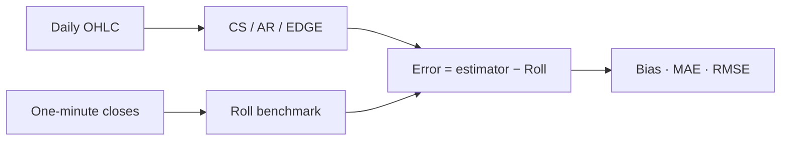

# Final presentation content

Primary evidence: frozen primary horse race. Sensitivities: prespecified robustness. Cross-fitted models: secondary diagnostic only. All displayed empirical values below are copied or unit-formatted from saved outputs, without re-estimation. The content is a slide plan, not a finished deck.

## Slide 1 — Title

# Which Daily OHLC Spread Estimator Tracks Realized Intraday Cost?
## A CS / AR / EDGE Horse-Race

Comparative evidence across stocks, ETFs, futures and crypto

Visual: minimal title treatment; no result table or implementation timeline.

## Slide 2 — Research question

**Which daily-OHLC spread estimator best matches a one-minute Roll benchmark, and where do the methods break down?**

Compare Corwin–Schultz, Abdi–Ranaldo and EDGE.

- EDGE expected to dominate accuracy.
- CS expected to be downward biased in thin markets.
- Rankings expected to be stable across asset classes.

**These are falsifiable hypotheses, not assumptions.**

Visual: question at top; three neutral hypothesis cards.

## Slide 3 — Data and design

Three liquidity tiers; selection frozen independently of estimator outcomes.

FX retained in scope but unavailable because official access remained blocked; no substitute data.

Footer: class calendars differ; futures cover their verified common year only. Common-defined conditioning can change the effective date/tier composition.

Visual: use this compact flow, not a dense coverage table.

## Slide 4 — How the horse race works

**All estimators use exactly the same asset-days.**

Footer: primary equal asset-day weighting; bps. HAC inference applies only to signed bias. MAE/RMSE rankings are descriptive.

Visual: parallel inputs converging into one comparison; no full derivations.

## Slide 5 — EDGE performs best overall

| Estimator | MAE (bps) | RMSE (bps) |
| --- | --- | --- |
| CS | 121.30 | 201.27 |
| AR | 127.71 | 257.71 |
| EDGE | 53.59 | 122.18 |

**EDGE roughly halves typical absolute benchmark error relative to CS / AR; the advantage is not universal.**

Visual: make this compact table dominant, with the existing estimator-versus-Roll scatter alongside or below it for benchmark context. Do not interpret the scatter as a significance test.

Visual: reuse the existing full figure, unchanged; retain its notes, units and transformed-axis labels. Full common-defined scatter; the table, not a fitted line, supplies the MAE/RMSE comparison.

Footer: descriptive accuracy; no formal statistical-superiority test for MAE/RMSE.

## Slide 6 — There is no universal estimator ranking

| Class | Lowest MAE | Lowest RMSE | Interpretation |
| --- | --- | --- | --- |
| Stocks | EDGE | CS | MIXED |
| ETFs | CS | CS | Same leader on both metrics |
| Futures | EDGE | EDGE | Same leader on both metrics |
| Crypto | EDGE | EDGE | Same leader on both metrics |

Visual: reuse the existing full figure, unchanged; retain its notes, units and transformed-axis labels. Read class-aggregate leaders from the matrix; the existing figure shows class × tier cells, whose boundaries can differ from the class aggregate.

## Slide 7 — Hypotheses: what survived?

| Hypothesis | Evidence | Assessment |
| --- | --- | --- |
| H1: EDGE dominates accuracy | Overall yes; universal no | Partially supported |
| H2: EDGE has lowest raw-negative rate | Lowest overall; class exceptions | Partially supported |
| H3: CS downward bias in LOW liquidity | Observed bias positive in every completed class | Not supported |
| H4: Rankings stable across classes | ETF and stock boundaries differ | Not supported |

Visual: neutral evidence matrix; equal visual weight for adverse and favorable findings. Use text labels, not red/green success/failure coding.

Footer: raw negatives are not estimation failures; conclusions concern this benchmark and sample.

## Slide 8 — Roll availability is the main sample bottleneck

**Roll undefined: 35.93% overall; 63.22% for ETFs.**

Accuracy is conditional on days where Roll and all methods are defined.

**Interpretation: best match to the Roll proxy—not the true best transaction-cost estimator.**

Visual: reuse the existing full figure, unchanged; retain its notes, units and transformed-axis labels. Emphasize the left-hand undefinedness panel. The right-hand R25/R50 panel is sensitivity evidence only, never the primary sample.

## Slide 9 — The overall conclusion survives the major sensitivity checks

| Prespecified sensitivity | What survives? | Boundary |
| --- | --- | --- |
| Roll R25 / R50 | EDGE overall leader; class leader patterns unchanged | Thin ETF tier cells tiny or unavailable |
| Equal-asset weighting | Overall and class leaders unchanged | Different estimand; does not cure selection |
| Bloomberg adjusted / unadjusted | Stock/ETF class leaders unchanged | Matched dates; local corporate-event caveats |
| EDGE abs-root | Overall EDGE leadership survives | Stocks switch to CS on both metrics |
| Leave-one-asset-out | Within-class MAE leaders stable | Stock RMSE changes when SNDL is omitted |

**Overall EDGE result survives the major applicable checks; local stock / thin-tier results are less stable.**

Visual: concise evidence rows; no new preferred specification or composite score.

## Slide 10 — Conclusion

- EDGE is the strongest overall estimator against the frozen Roll benchmark.
- Method choice depends on asset class and error criterion: ETFs favor CS; stocks are mixed; futures and crypto favor EDGE.
- Benchmark availability limits the conclusion to agreement with Roll, rather than true effective execution cost.

**Daily OHLC spread estimators are useful, but they are not interchangeable across market structures.**

Visual: no table; three bullets only, followed by the closing sentence.

---

# Optional appendix: not in the default speaking budget

## Appendix A1 — Estimator error is partly predictable

**Secondary / diagnostic only: estimator error is partly predictable.**

| Estimator | Absolute-error cross-fitted R² |
| --- | --- |
| CS | 0.305 |
| AR | 0.162 |
| EDGE | 0.239 |

Visual: reuse the existing full figure, unchanged; retain its notes, units and transformed-axis labels. High-low range, open-close movement and asset class matter; liquidity tier is weak/unstable conditional on these features.

Association only: no causal claim, trading forecast or new spread estimator. Price-condition features overlap estimator inputs; pooled fit can hide adverse class-specific fit. The lagged placebo retains predictability.

Optional talk insert: replace the main robustness slide with this slide if a diagnostic discussion is specifically requested; otherwise use only in Q&A. Do not silently add it to the default main-slide count.

## Appendix A2 — Exact selected universe

| Class | Tier | Frozen assets / roots |
| --- | --- | --- |
| stocks | LOW | IMDX, AIRG, CCBG |
| stocks | MEDIUM | ANGO, SNDL, FCPT |
| stocks | HIGH | FDS, XPO, BIDU |
| etfs | LOW | SDCI, AAA, JSML |
| etfs | MEDIUM | PGJ, PJAN, FSMD |
| etfs | HIGH | SPBO, SCHM, MCHI |
| futures | LOW | HG, AD, B6 |
| futures | MEDIUM | J1, GC, E6 |
| futures | HIGH | NQ, ZF, ES |
| crypto | LOW | ICX, NEO, DASH |
| crypto | MEDIUM | ZEC, ALGO, MKR |
| crypto | HIGH | NEAR, LINK, DOGE |

No performance-based replacement; REIT/ADS included under the stock rule. IMDX continuity remains uncertified.

## Appendix A3 — Estimator definitions and daily mappings

| Method | Conceptual formula | Frozen mapping | Negative / undefined rule |
| --- | --- | --- | --- |
| ROLL | 2 sqrt(-sample lag-1 covariance of adjacent simple one-minute returns) | Within frozen asset-session/day; ddof=1; minimum 2 pairs | Nonnegative covariance undefined/NaN; never zero |
| CS | Overnight-adjusted two-session beta/gamma -> alpha -> 2 tanh(alpha/2) | Mean corrected intervals (t-1,t) and (t,t+1); both required | Floor each finite interval separately before averaging; retain raw daily signed mean |
| AR | s2=4(log(C_t)-eta_t)(log(C_t)-eta_(t+1)); eta=(log(H)+log(L))/2 | Assigned to target t; no carry-forward or author empirical imputation | sqrt(max(s2,0)); finite negative raw moment remains defined |
| EDGE | Published Eq26 minimum-variance combination of OHLC log-return moments | Centered three scheduled sessions; local RMS spread assigned to t | sqrt(max(raw s2,0)); abs-root is robustness only |

Project mappings are ex-post measurements, not trading signals. No missing-minute filling, gap bridging, carry-forward or compressed missing sessions. Roll computability is not a precision guarantee.

## Appendix A4 — Class × liquidity accuracy

| Class | Tier | Method | MAE (bps) | RMSE (bps) | Common N |
| --- | --- | --- | --- | --- | --- |
| crypto | HIGH | CS | 178.02 | 241.95 | 3,710 |
| crypto | HIGH | AR | 161.05 | 289.90 | 3,710 |
| crypto | HIGH | EDGE | 21.64 | 45.60 | 3,710 |
| crypto | LOW | CS | 165.49 | 246.00 | 2,292 |
| crypto | LOW | AR | 167.39 | 283.95 | 2,292 |
| crypto | LOW | EDGE | 65.41 | 128.56 | 2,292 |
| crypto | MEDIUM | CS | 205.03 | 304.11 | 3,826 |
| crypto | MEDIUM | AR | 184.72 | 334.72 | 3,826 |
| crypto | MEDIUM | EDGE | 39.71 | 80.10 | 3,826 |
| etfs | HIGH | CS | 20.61 | 36.51 | 1,839 |
| etfs | HIGH | AR | 34.63 | 68.24 | 1,839 |
| etfs | HIGH | EDGE | 23.29 | 44.49 | 1,839 |
| etfs | LOW | CS | 22.61 | 41.34 | 245 |
| etfs | LOW | AR | 40.68 | 78.27 | 245 |
| etfs | LOW | EDGE | 31.31 | 58.07 | 245 |
| etfs | MEDIUM | CS | 32.20 | 59.35 | 1,091 |
| etfs | MEDIUM | AR | 54.94 | 110.22 | 1,091 |
| etfs | MEDIUM | EDGE | 40.04 | 76.31 | 1,091 |
| futures | HIGH | CS | 21.42 | 36.90 | 521 |
| futures | HIGH | AR | 21.31 | 43.42 | 521 |
| futures | HIGH | EDGE | 5.34 | 11.46 | 521 |
| futures | LOW | CS | 25.06 | 40.17 | 590 |
| futures | LOW | AR | 24.65 | 50.61 | 590 |
| futures | LOW | EDGE | 5.19 | 10.85 | 590 |
| futures | MEDIUM | CS | 23.00 | 32.26 | 556 |
| futures | MEDIUM | AR | 23.82 | 42.10 | 556 |
| futures | MEDIUM | EDGE | 5.34 | 10.77 | 556 |
| stocks | HIGH | CS | 67.51 | 97.45 | 3,481 |
| stocks | HIGH | AR | 88.00 | 161.87 | 3,481 |
| stocks | HIGH | EDGE | 56.17 | 96.41 | 3,481 |
| stocks | LOW | CS | 146.11 | 216.76 | 2,399 |
| stocks | LOW | AR | 186.20 | 326.42 | 2,399 |
| stocks | LOW | EDGE | 125.02 | 215.48 | 2,399 |
| stocks | MEDIUM | CS | 112.36 | 179.33 | 3,827 |
| stocks | MEDIUM | AR | 130.59 | 289.22 | 3,827 |
| stocks | MEDIUM | EDGE | 85.13 | 190.59 | 3,827 |

Q&A reference table, not a dense main slide. Descriptive rankings; identical rows per method within a cell; effective common-date composition can differ across tiers.

## Appendix A5 — Failure and raw-negative rates

**Failures: all design-eligible days.**

| Method | Undefined N | Design N | Failure rate |
| --- | --- | --- | --- |
| ROLL | 13,738 | 38,232 | 35.93% |
| CS | 524 | 38,232 | 1.37% |
| AR | 96 | 38,232 | 0.25% |
| EDGE | 231 | 38,232 | 0.60% |

**Raw-negative rates: method-specific finite raw-computable days.**

| Method | Negative N | Raw-computable N | Raw-negative rate |
| --- | --- | --- | --- |
| CS | 14,942 | 37,708 | 39.63% |
| AR | 18,401 | 38,136 | 48.25% |
| EDGE | 14,962 | 38,001 | 39.37% |

A negative finite raw estimate is not a failure. EDGE has the lowest raw-negative rate overall; CS is lower in futures and crypto. Do not change these denominators to common-defined N.

## Appendix A6 — Roll quality sensitivities

| Sensitivity | Pair-coverage floor | Common N | EDGE MAE (bps) | EDGE RMSE (bps) | LOW ETF N |
| --- | --- | --- | --- | --- | --- |
| Roll R25 | 25% | 16,150 | 48.95 | 121.11 | 6 |
| Roll R50 | 50% | 12,908 | 47.71 | 121.95 | 0 |

Coverage uses valid Roll pairs divided by regular-envelope pair opportunities. Short/early-close sessions can score lower; these opportunities are not synthetic bars. Overall EDGE and class-level leader patterns persist, but sparse tier comparisons do not. Sensitivities only; never preferred primary exclusions.

## Appendix A7 — Cross-fitted model details and placebo

Five chronological test folds; one-percent embargo = 21 subsequent target dates where available. Exact information-interval purging; train-only preprocessing; fixed HistGradientBoostingRegressor with no tuning; test-only permutation importance.

Block cross-fitting may train on later non-overlapping periods: ex-post diagnostic, not a forward trading forecast. Signed and absolute errors are separate targets.

The scheduled one-period lag placebo retains substantial predictability; AR/EDGE weaken by pooled R² and RMSE, while CS does not. Tier importance is conditional, not evidence that liquidity is irrelevant.

Source: [saved diagnostic review](../outputs/diagnostics/error_model/step20_cross_fitted_error_model_review.md).

## Appendix A8 — Source and calendar limitations

| Class | Design start | Design end |
| --- | --- | --- |
| stocks | 2019-08-01 | 2025-12-31 |
| etfs | 2020-09-15 | 2025-12-31 |
| futures | 2024-01-02 | 2024-12-31 |
| crypto | 2022-02-01 | 2025-12-31 |

- Bloomberg adjusted OHLC for stock/ETF estimates; First Rate minute benchmark. CshAdjAbnormal = UNKNOWN; daily/RTH equivalence uncertified.
- Futures: provider-selected individual unadjusted contracts; no continuous adjusted prices or silent substitution. Historical extras remain supplementary.
- Crypto/futures share minute inputs across daily estimates and Roll. Crypto formal quote currency = UNKNOWN; do not label it USD.
- Liquidity tiers use 2024 turnover: look-ahead before calibration, and futures comparison is in-calibration-year. Selection predates performance.
- IMDX historical continuity uncertified; no OCX stitching. FX official access blocked; no substitute.
- Roll is a proxy and common-defined conditioning selects observations. Class calendars differ; this is not a balanced all-class historical panel.
- MAE/RMSE rankings descriptive; HAC only for bias. Cross-fitted models associative; no causal/trading claim.

Source/lineage: [manifest](../manifests/data_manifest.csv), [attrition](../manifests/sample_attrition.csv), [frozen decisions](../design_decisions.md).

Audit scope: empirical values, dates, method settings, qualitative conclusions and inherited figure labels/data summaries are linked to frozen sources. Slide numbers, hypothesis labels, figure axis ticks and proposed speaking times are editorial structure, not new empirical results. Figure hashes retain the existing full-range plots; plotted observations are not copied into the audit.
